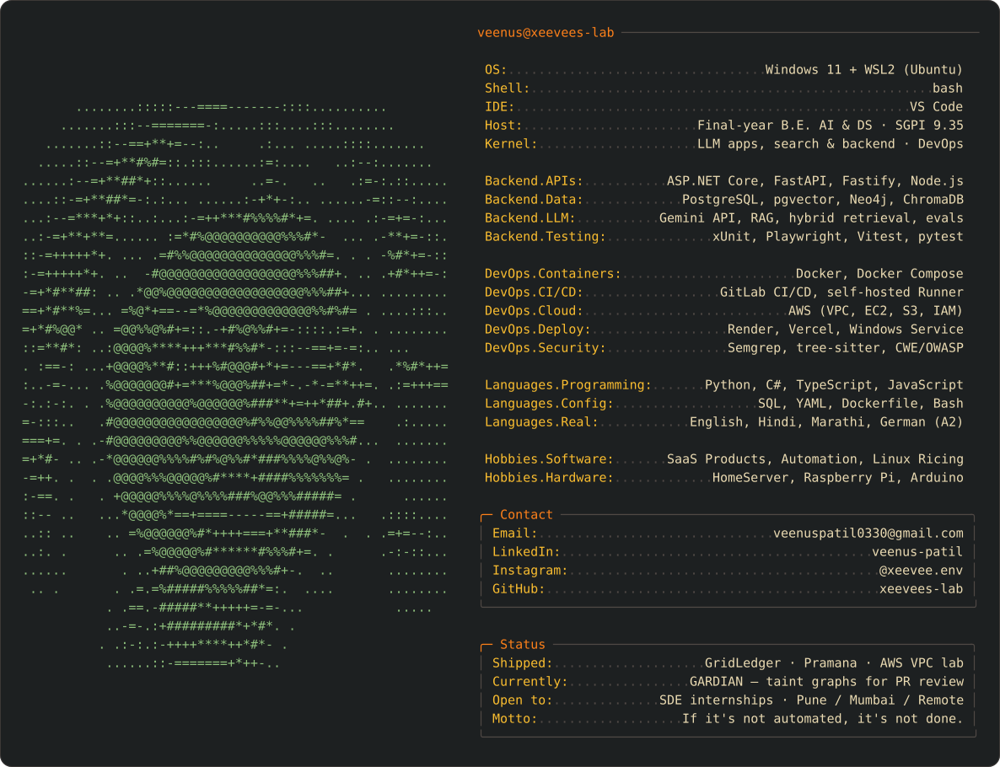
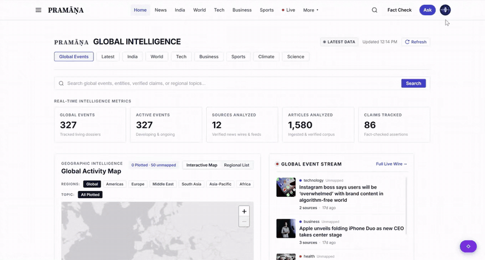

<div align="center">



<br>

<a href="https://github.com/xeevees-lab">
  
</a>

<sub><b>Final-year B.E. AI &amp; Data Science</b> · SGPI 9.35 &nbsp;|&nbsp; Thane / Mumbai, India &nbsp;|&nbsp; Backend · LLM &amp; search · DevOps</sub>

<a href="https://linkedin.com/in/veenus-patil"></a>
<a href="mailto:veenuspatil0330@gmail.com"></a>
<a href="https://instagram.com/xeevee.env"></a>


</div>

<h2 align="center">◆ &nbsp;GARDIAN&nbsp; ◆</h2>

<div align="center">

**G**raph-**A**ugmented **R**AG **D**etection with **I**ntelligent **A**gent **N**etwork &nbsp;·&nbsp; <i>final-year major project, team of 4</i>

<i>Reviews pull requests for security holes — and reports only the ones an attacker can actually reach.</i>


<a href="mailto:veenuspatil0330@gmail.com?subject=GARDIAN%20walkthrough"></a>

</div>

<table>
<tr>
<td width="50%" valign="top">

### The problem

Static analysers are loud — hundreds of findings, most unreachable. Reviewers stop reading at forty.

### What GARDIAN does

It doesn't detect harder — it **checks reachability**. Code becomes a Neo4j graph, and a Cypher query traces untrusted input to SQL, shell and `eval` sinks.

Edges carry the **argument position**, so a parameterised query is *not* flagged. Findings are grounded in CWE/OWASP and posted on the PR.

</td>
<td width="50%" valign="top">

### The pipeline

```
 pull request  (PyGithub)
     ▼
 ① tree-sitter .... parse
     ▼
 ② Neo4j CPG ...... data flow
     ▼
 ③ Cypher ......... taint path
     ▼
 ④ RAG ............ CWE · OWASP
     ▼
 PR comment: CWE · flow · fix
     ┊  planned
 ⑤ cross-file taint
 ⑥ LangGraph agents
 ⑦ sandbox-verified patch
```

<sub>①–④ built · unit tests on a self-hosted GitLab Runner · ⑤–⑦ next</sub>

</td>
</tr>
</table>

<details>
<summary><b>&nbsp;Results, decisions & constraints&nbsp;</b></summary>

<br>

**Labelled fixtures** — 4 files, `expected.json` as ground truth:

| Fixture | Expected | GARDIAN | Semgrep CE `p/python` |
| :--- | :---: | :---: | :---: |
| SQLi, direct | CWE-89 | ✅ flagged | ✅ flagged |
| SQLi, 4-hop chain | CWE-89 | ✅ flagged | ⚠️ flagged as CWE-704 |
| Command injection (`os.system`) | CWE-78 | ✅ flagged | ❌ missed |
| Parameterised query | safe | ✅ silent | ✅ silent |

<br>

| Decision | Why |
| :--- | :--- |
| **`HAS_ARG {arg_index}` + per-sink `tainted_args`** | The single reason the parameterised query isn't a false positive. |
| **Taint paths use `*0..N`, not `*1..N`** | `os.system(host)` with no intermediate variable is a zero-hop path. |
| **Recursive node walk, not `queries.scm`** | The py-tree-sitter query API keeps changing shape; a walk survives `pip install -U`. |
| **Semgrep runs as a pinned container** | Its `opentelemetry-sdk` pin breaks the venv — and a containerised baseline is reproducible by anyone. |
| **Zero cash, self-hosted** | Neo4j and the CI runner live in local Docker on WSL2. A security tool you can't run on your own infrastructure is one most teams can't adopt. |

<br>

`Python` · `Pydantic` · `tree-sitter` · `Neo4j` · `Cypher` · `ChromaDB` · `sentence-transformers` · `PyGithub` · `Semgrep CE` · `Docker` · `GitLab CI` · `pytest`

</details>

<div align="center">

</div>

<h2 align="center">◆ &nbsp;GridLedger&nbsp; ◆</h2>

<div align="center">

Real-time energy monitoring and electricity-cost control for HT industrial plants.

<i>Shows a factory its electricity bill before the utility does — and how to cut it.</i>

<a href="https://github.com/xeevees-lab/gridledger"></a>


</div>

<table>
<tr>
<td width="50%" valign="top">

### What it does

A .NET **Windows service** reads energy meters over **Modbus RTU and TCP**, with auto-discovery and a data-quality guard.

It prices every 15 minutes against the published **MSEDCL HT tariff** — demand blocks, kVAh charges, time-of-day rebates — then forecasts load and plans how to shift it off peak.

</td>
<td width="50%" valign="top">

### The engine

```
 energy meters
   │ Modbus RTU / TCP
   ▼
 ① poller ....... DQ guard
   ▼
 ② PostgreSQL ... 15-min blocks
   ▼
 ③ shadow bill .. kVAh · ToD
   ├─► LightGBM forecast
   ├─► OR-Tools load-shift
   ▼
 dashboard + email / Teams
```

</td>
</tr>
</table>

<details>
<summary><b>&nbsp;Controls & testing&nbsp;</b></summary>

<br>

| Area | What's in place |
| :--- | :--- |
| **Audit** | Controls designed to support 21 CFR Part 11 — role-based access, e-signatures, hash-chained audit trail |
| **Security** | Argon2id credentials, dashboard behind a key-secured YARP reverse proxy |
| **Testing** | xUnit + Playwright on simulated meter data; API fuzzing cut server errors from 41 to 0 |
| **Forecasting** | ML.NET LightGBM against a seasonal baseline; Google OR-Tools load-shifting plans |

<br>

`C#` · `.NET 10` · `ASP.NET Core` · `NModbus` · `PostgreSQL 17` · `ML.NET` · `OR-Tools` · `React` · `TypeScript` · `Playwright`

</details>

<div align="center">

</div>

<h2 align="center">◆ &nbsp;Pramāṇa&nbsp; ◆</h2>

<div align="center">

<b>प्रमाण</b> — <i>"a valid means of knowledge."</i> &nbsp;An LLM news-intelligence platform that separates verified fact from contested claim.

<i>Shows what's verified in the news, what's disputed, and which outlets say what.</i>

<a href="https://github.com/xeevees-lab/pramana"></a>
<a href="./assets/pramana-demo.mp4"></a>


<a href="./assets/pramana-demo.mp4"></a>

<sub><i>Live dashboard → claim audit → Intelligence search. &nbsp;Click for the full 2-minute walkthrough.</i></sub>

</div>

<table>
<tr>
<td width="50%" valign="top">

### The problem

Feeds show people news that already agrees with them — the same event, told as two different stories.

### What Pramāṇa does

It ingests RSS, GDELT and NewsAPI every 15 minutes, clusters events, and splits coverage into **atomic claims** — each shown with the outlets that back or dispute it.

Retrieval is measured, not vibes: a 10-category golden benchmark.

</td>
<td width="50%" valign="top">

### The retriever

```
 query
   ▼
 ① intent + thread memory
   ▼
 ② 4 parallel recall lanes
    lexical · pgvector HNSW
    Neo4j graph · event link
   ▼
 ③ weighted rerank → gate
   ▼
 ④ Gemini → answer + ledger
```

<sub>768-d embeddings · 18-table schema mirrored into Neo4j · ~15.5k lines</sub>

</td>
</tr>
</table>

<p align="center">
<code>Gemini API</code> · <code>PostgreSQL</code> · <code>pgvector</code> · <code>Neo4j</code> · <code>Node.js</code> · <code>Fastify</code> · <code>React</code> · <code>Vitest</code> · <code>Render</code> · <code>Vercel</code>
</p>

<div align="center">

</div>

<h2 align="center">◆ &nbsp;Also built&nbsp; ◆</h2>

<table>
<tr>
<td width="33%" valign="top">

#### [AWS VPC Peering Lab](https://github.com/xeevees-lab/aws-vpc-peering-lab)

Two peered VPCs, private EC2s reached through one bastion — then **broke an SG rule on purpose** to prove it controls reachability.

<sub>`AWS VPC` · `EC2` · `Security Groups`</sub>

</td>
<td width="33%" valign="top">

#### [Network Intelligence Dashboard](https://github.com/xeevees-lab/network-intelligence-dashboard)

FastAPI recon tool: **raw-socket port scanner** (100 workers, no nmap), IP geolocation, scan history.

<sub>`Python` · `FastAPI` · `Docker`</sub>

</td>
<td width="33%" valign="top">

#### [Docker-Setup](https://github.com/xeevees-lab/Docker-Setup)

Python 2.7 on Kali, **isolated in a container** instead of breaking the system interpreter.

<sub>`Docker` · `Kali Linux`</sub>

</td>
</tr>
</table>

<div align="center">

</div>

<h2 align="center">◆ &nbsp;Stack&nbsp; ◆</h2>

<table align="center">
<tr>
<td align="right" width="150"><b>Infra&nbsp;&&nbsp;CI</b></td>
<td>


</td>
</tr>
<tr>
<td align="right"><b>Backend&nbsp;&&nbsp;Data</b></td>
<td>


</td>
</tr>
<tr>
<td align="right"><b>LLM&nbsp;&&nbsp;Retrieval</b></td>
<td>


</td>
</tr>
<tr>
<td align="right"><b>Security&nbsp;&&nbsp;Testing</b></td>
<td>


</td>
</tr>
<tr>
<td align="right"><b>Languages</b></td>
<td>


</td>
</tr>
</table>

<div align="center">

</div>

<h2 align="center">◆ &nbsp;Activity&nbsp; ◆</h2>

<div align="center">

<sub><i>Much of my day-to-day work lives in private repos — the numbers below only tell part of the story.</i></sub>

<br><br>


<br><br>

<picture>
  <source media="(prefers-color-scheme: dark)" srcset="https://raw.githubusercontent.com/xeevees-lab/xeevees-lab/output/snake-dark.svg">
  <source media="(prefers-color-scheme: light)" srcset="https://raw.githubusercontent.com/xeevees-lab/xeevees-lab/output/snake.svg">
  
</picture>


<h3><i>"If it's not automated, it's not done."</i></h3>

<a href="mailto:veenuspatil0330@gmail.com"></a>

<br>


</div>
